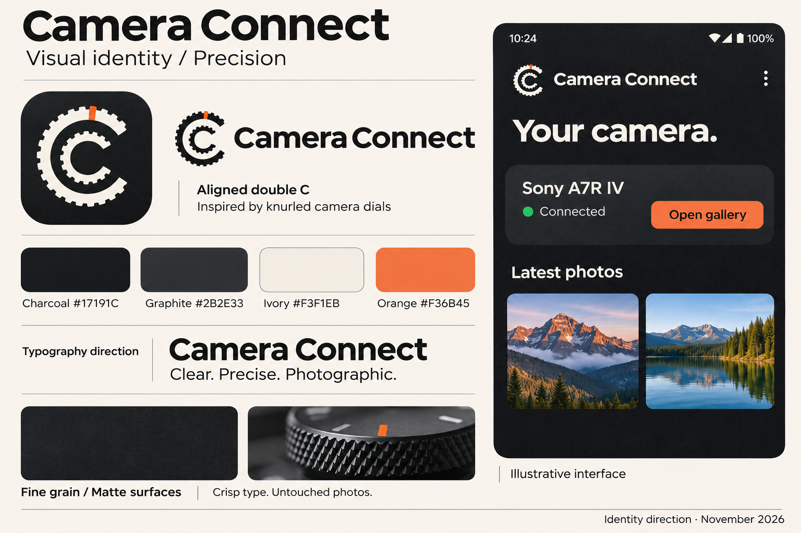

# Camera Connect visual identity

Decision record · 10 November 2026

The selected direction is **Precision**: a dependable photographic tool with the tactile character of camera hardware. The identity combines aligned, nested C-shaped camera dials, charcoal surfaces, warm ivory, an orange index mark, and subtle grain.

## Status and files

This document records the agreed creative direction and its implementation. The board remains an illustrative raster concept; the app uses the vector assets and theme described below, not a crop of the board.

- [Consolidated identity board](identity-board.png): the current visual reference.
- [Board generation prompt](generation-prompt.md): the prompt that produced the board.

Use the written naming rules and color values below as the source of truth. Generated artwork can have slight variations in geometry, texture, and color.

## Name

**Camera Connect** is the public-facing name. Use this spelling, capitalization, and space in the app, launcher label, wordmark, and user-facing documentation. Keep the name unchanged in English and French.

`camera-connect` is the repository and technical spelling. Existing package names and other technical identifiers do not need to change as a consequence of this branding decision.

## Logo: aligned double C

The mark represents the two initials of **Camera Connect** through two concentric C-shaped rings inspired by the knurled adjustment dials on cameras.

- Both rings open to the right, with their gaps aligned.
- The inner ring is smaller and clearly separated from the outer ring by negative space.
- Both outer edges have short, shallow teeth suggesting a camera dial's grip.
- One orange index mark accents the outer ring.
- The primary treatment is ivory on charcoal.
- Keep the logo shapes crisp and solid; grain belongs to the surrounding surface.

The silhouette should feel like a photographic instrument. Avoid long gear teeth, extra Wi-Fi symbols, aperture blades, camera silhouettes, or additional symbols inside the mark.

### Vector assets

The aligned mark is now drawn as scalable vector geometry:

- [Color SVG master](assets/camera-connect-mark.svg)
- [Single-color SVG master](assets/camera-connect-mark-mono.svg)
- Android foreground: `app/src/main/res/drawable/ic_launcher_foreground.xml`
- Android themed icon: `app/src/main/res/drawable/ic_launcher_monochrome.xml`
- Toolbar mark: `app/src/main/res/drawable/ic_brand_mark.xml`

The SVG files are the editable master artwork. The Android vector XML files are ready-to-use app assets. No generation script or build-time generation is required. For future logo changes, edit the SVG masters and update the corresponding Android vectors to match.

Both openings span 80 degrees, centered on the right. On the 108-unit launcher canvas, the outer ring has radius 30, inner edge 22, and 24 shallow teeth along its visible arc. The smaller ring has radius 18, inner edge 12, and 16 teeth. The orange index sits near twelve o'clock on the outer ring. The silhouette fits within a 60-unit circle centered on the canvas, inside the adaptive icon's 66-unit safe circle. Android supplies the launcher mask; the foreground has no baked-in rounded-square background. The toolbar version crops to a 68-unit viewport and is displayed at 36 dp.

The monochrome asset has a single solid color, including its index. The app's horizontal lockup combines the vector mark with live **Camera Connect** text. Final optical review on actual launcher sizes and device screens remains pending.

## Palette

| Color | Value | Intended role |
| --- | --- | --- |
| Charcoal | `#17191C` | Main dark surface and dark foreground on orange |
| Graphite | `#2B2E33` | Supporting surfaces and device cards |
| Ivory | `#F3F1EB` | Primary text and logo on dark backgrounds; presentation background |
| Orange | `#F36B45` | Outer-ring index, primary actions, selected emphasis |

Charcoal, ivory, and orange define the identity. Graphite supports the dark interface. Use orange sparingly so it retains emphasis. Photography supplies most of the screen's color.

The board uses charcoal lettering on orange actions. Validate contrast for every final text, icon, state, and textured surface. Do not assume the board's raster samples are exact color tokens. Status colors such as the illustrative green connection indicator are functional colors, not additional approved brand colors; define and validate those during implementation and pair them with text.

## Typography

The agreed direction is bold, modern grotesk sans-serif typography for the **Camera Connect** wordmark, with clean, readable sans-serif text in the app. Use a clear hierarchy and restrained supporting labels.

Implementation uses Android’s bundled `FontFamily.SansSerif`, with bold headings, semibold titles/actions, and regular body text. No external font download or extra font license is required. The type scale lives in `ui/theme/Theme.kt`; body text is 16/24 or 14/22 sp, the home headline is 32/40 sp, and the toolbar title is 22/28 sp. Text uses scalable units and French resources. The generated board lettering remains a style reference, not the exact runtime font.

## Grain and material

Fine grain is part of the identity. It should recall matte camera hardware and photographic material, with a subtle tonal variation that is felt before it is noticed.

- Apply fine monochromatic grain to charcoal backgrounds and, where useful, graphite cards.
- Keep it static, restrained, and consistent in apparent scale.
- Keep text, icons, logo shapes, and controls sharp.
- Never texture, tint, or otherwise alter users' photo thumbnails, previews, or downloaded images.
- Avoid scratches, heavy distress, coarse speckles, visible tiling, and glossy effects.

The board makes the texture visible for discussion. Implementation uses one deterministic 128 × 128 pixel noise tile, created lazily and repeated with a bitmap shader. Black noise at 0–12/255 opacity subtly darkens the base without reducing contrast for light or orange foregrounds. Cached drawing paints behind content; there is no per-frame random generation. Home surfaces, cards, gallery background, and the download panel use it. Actual image pixels and the black photo-viewing area stay clean. Grain strength still needs optical review on a real device.

## Interface direction

Use a calm dark interface with clear connection status, a prominent action, and generous space for photography. Device cards may provide a tactile graphite surface; galleries and previews should keep surrounding chrome quiet and neutral.

The screen on the board is illustrative. Its layout, sample photographs, headings, and latest-photo section are not a final screen specification or new feature commitment. No official Sony affiliation is implied by identifying the supported camera.

Implementation must preserve the app's actual behavior: connect over Wi-Fi, browse and preview photos, and download the available rendition. In particular, retain the RAW-only notice explaining that the camera exposes a JPEG rendition rather than a transferable original ARW file. Keep connection errors and transfer progress legible, and localize new UI copy in English and French.

The implementation deliberately uses the fixed dark Precision theme in both system appearances. Android wallpaper-derived dynamic colors are disabled to preserve the palette. Status and navigation bars use light icons, and the launch window uses charcoal. A separate light theme is outside this version.

## Implemented interface styling

- Home: vector brand lockup, localized introduction, matte graphite cards, orange primary actions, and a bounded content width on larger screens.
- Gallery: neutral photo backgrounds, restrained rounded corners, wider gutters, and a readable RAW badge.
- Preview: clean black image area, clipped zoom content, matte download panel, navigation-bar inset, and consistent 52 dp minimum primary actions.
- Shared theme: fixed semantic colors, sans-serif typography, restrained corner radii, and contrast-safe dark lettering on orange buttons. The debug screen inherits the same theme.

Existing connection, language, camera instruction, download, error, and RAW-rendition behavior is retained. The illustrative “latest photos” home section from the board is not a new feature in this implementation.

## Contrast

Base palette contrast ratios: ivory/charcoal **15.59:1**, ivory/graphite **12.06:1**, charcoal/orange **5.87:1**, secondary text/graphite **7.57:1**, orange/graphite **4.54:1**. Grain only darkens surfaces; opaque orange buttons do not receive grain.

## Remaining checks

Review on a real device, in English and French: the home, connection and error states, the gallery, and the preview and download states. Check a narrow display, a large font scale, gesture and three-button navigation, themed launcher masks, and the grain at device resolution.

## Provenance

The board is generated illustrative material: its photographs, textures and interface elements are neither app screenshots nor licensed assets. [generation-prompt.md](generation-prompt.md) keeps the prompt that produced it.
